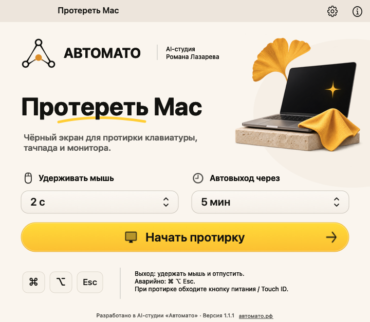
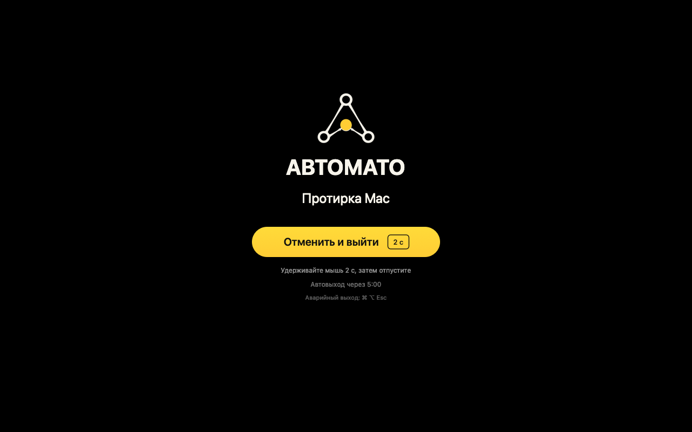

# Протереть Mac · Автомато

Небольшое бесплатное приложение для протирки клавиатуры, тачпада и экрана MacBook. Нажимаешь «Начать протирку» — появляется чёрный экран, обычные нажатия клавиш, случайные клики и прокрутка блокируются. После уборки удерживаешь мышь на жёлтой кнопке и отпускаешь.

[**Скачать для macOS**](https://github.com/RomanBotan47/mac-wipe/releases/latest) · [Автомато](https://автомато.рф) · [Исходный код](MacWipe.swift)



## Установка

Требуется **macOS 13 или новее**. Универсальная сборка включает **Apple Silicon и Intel**.

1. Открой [последний релиз](https://github.com/RomanBotan47/mac-wipe/releases/latest) и скачай `MacWipe-1.1.1-universal.dmg`.
2. Открой DMG и перетащи «Протереть Mac» в папку «Программы». Также доступен ZIP с тем же приложением.
3. Запусти приложение. В разделе **Системные настройки → Конфиденциальность и безопасность → Универсальный доступ** включи «Протереть Mac».
4. Вернись в приложение. Блок с просьбой о разрешении исчезнет, кнопка запуска станет доступной.

### Первый запуск и проверка загрузки

У версии 1.1.1 есть локальная **ad-hoc подпись**. Она **не имеет Developer ID и нотариализации Apple**, поэтому macOS может предупредить о непроверенном разработчике. Решение доверять загрузке принимает владелец Mac. Стандартный путь подтверждения отдельного приложения описан в [официальной инструкции Apple](https://support.apple.com/ru-ru/102445): после попытки запуска — «Конфиденциальность и безопасность» → «Всё равно открыть» (Open Anyway). Глобальные настройки Gatekeeper менять не требуется.

В каждом релизе есть `SHA256SUMS.txt`. Проверить скачанный DMG можно командой:

```sh
shasum -a 256 MacWipe-1.1.1-universal.dmg
```

Сравни результат со строкой для этого файла в `SHA256SUMS.txt`. Можно также собрать приложение самостоятельно по инструкции ниже.

## Как пользоваться

- Выбери удержание мыши **от 1 до 10 секунд** и автовыход **от 1 до 15 минут**. Значения сохраняются на твоём Mac.
- Нажми **«Начать протирку»**. Все подключённые экраны станут чёрными.
- Для выхода удерживай левую кнопку мыши на жёлтой кнопке **«Отменить и выйти»**, затем отпусти. Подойдёт также нажатие тачпада. Короткий клик оставляет протирку включённой; движение за пределы кнопки отменяет удержание.
- Аварийный выход — **⌘⌥Esc**. Дополнительно работает обязательный автовыход.



Кнопка питания / Touch ID и другие аппаратные действия остаются под управлением macOS. При протирке обходи кнопку питания. Для влажной чистки следуй [рекомендациям Apple](https://support.apple.com/ru-ru/103258); приложение управляет вводом и экраном.

## Приватность и защита от зависания

- Приложение работает локально. В исходниках нет телеметрии, аналитики, загрузки файлов, обновлятора, серверного API и сетевого слушателя.
- Сетевые запросы самим приложением не выполняются. Нажатие ссылки `автомато.рф` открывает сайт в браузере по выбору пользователя.
- Клавиши и набранный текст не записываются. Для аварийной команды проверяется только код Esc и флаги модификаторов.
- Сохраняются только два числа: длительность удержания мыши и время автовыхода.
- Отдельный дочерний процесс следит за сигналом основного процесса. При зависании он завершает только породившее его приложение; таймер учитывает время сна компьютера.
- Если macOS отключает фильтр ввода, приложение прекращает протирку и освобождает ввод. При завершении процесса фильтр удаляется системой.
- Для работы используется стандартное разрешение Accessibility. Оно позволяет перехватывать ввод; выдавай его только приложению, источнику которого доверяешь. Отозвать разрешение можно в системных настройках.

В репозитории и релизах отсутствуют доступы автора к хостингу, Telegram, GitHub и другим сервисам. CI использует временный токен этого репозитория только для публикации релизов. Разрешения CI ограничены, сборка выполняется на GitHub-hosted runners.

## Сборка из исходников

Нужны macOS и Apple Command Line Tools (`xcode-select --install`). Сторонние библиотеки и пакетные менеджеры для сборки не используются.

```sh
git clone https://github.com/RomanBotan47/mac-wipe.git
cd mac-wipe
./build.sh
python3 scripts/test-safety.py
```

Готовое универсальное приложение: `build/Протереть Mac.app`.

```sh
./scripts/package.sh
```

DMG, ZIP и контрольные суммы появятся в `build/release/`. Локальная подпись привязана к сборке. После замены собственной сборки при необходимости удали прежнюю запись приложения из «Универсального доступа», добавь текущий файл заново и подтверди разрешение.

## Лицензия и автор

[MIT](LICENSE). Разработано в AI-студии «Автомато», Роман Лазарев. Иллюстрация ноутбука создана GPT Image, [запрос сохранён](Assets/HeroPrompt.txt). Логотипы предоставлены автором.

[Сообщить об ошибке](https://github.com/RomanBotan47/mac-wipe/issues) · [Безопасность](SECURITY.md)
